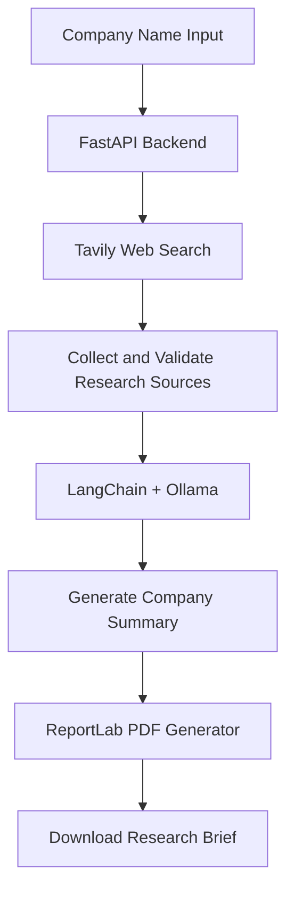
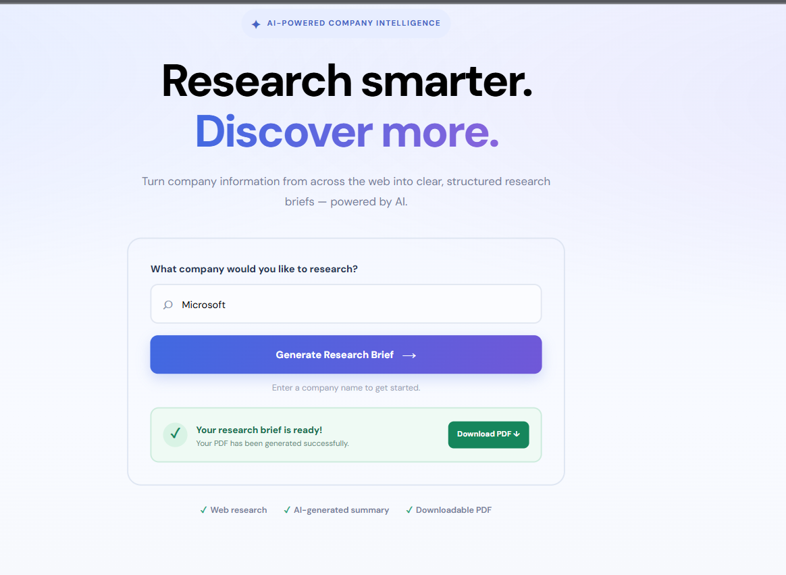
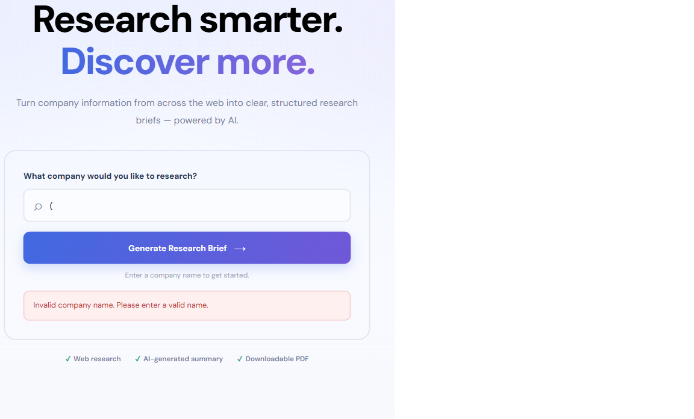

# Company Research Agent – ResearchIQ

An AI-powered Company Research Agent that searches the web, generates AI-assisted company summaries, and creates professional downloadable PDF research briefs.

**🎥 Project Demonstration:** [Watch the Loom Demo](https://www.loom.com/share/b0e2104f401449138a77972246192060)

## 🚀 Live Deployment

**Live Application:** https://taw-agents-research-agent-rn7y6kj23-bushra-e0e6.vercel.app/

## Problem

Consultants and business professionals often spend considerable time gathering company information from multiple websites and organizing it into research documents. This project automates that initial research process.

## Who Is It For?

- Business consultants
- Market researchers
- Business analysts
- Professionals who need quick company research

## Features

- Accepts a company name through a web interface.
- Searches the web for relevant company information using Tavily.
- Collects research sources, titles, URLs, and content.
- Generates AI-assisted company summaries using a local language model.
- Creates downloadable PDF research briefs.
- Includes source links for information verification.
- Validates company names and handles invalid inputs.
- Provides a simple web interface for users.

## Technology Stack

- **Language:** Python
- **Backend:** FastAPI
- **AI Orchestration:** LangChain
- **Language Model:** Ollama with Llama 3.2 (1B)
- **Web Search:** Tavily
- **PDF Generation:** ReportLab
- **Frontend:** HTML, CSS, JavaScript
- **Template Engine:** Jinja2
- **Server:** Uvicorn
- **Configuration:** Python dotenv

## Architecture



## Screenshots

### ResearchIQ Homepage


### Successful Company Research



### Generated PDF Report


### Input Validation



## Project Structure

```text
taw-agents-research-agent/
│
├── app/
│   ├── main.py
│   ├── services/
│   │   ├── research.py
│   │   ├── summary.py
│   │   └── pdf_generator.py
│   ├── templates/
│   │   └── index.html
│   ├── static/
│   │   ├── css/
│   │   │   └── style.css
│   │   └── js/
│   │       └── app.js
│   ├── test_ollama.py
│   └── test_tavily.py
│
├── screenshots/
│   ├── Research-IQ Homepage.png
│   ├── research-result.png
│   ├── PDF generated.png
│   └── error-validation.png
│
├── generated/
├── tests/
├── .env.example
├── .gitignore
├── README.md
├── requirements.txt
└── requirements-lock.txt
```

## Setup Instructions

### 1. Clone the repository

```bash
git clone https://github.com/bushra0909/taw-agents-research-agent.git
cd taw-agents-research-agent
```

### 2. Create and activate a virtual environment

For Windows:

```bash
python -m venv venv
venv\Scripts\activate
```

### 3. Install dependencies

```bash
pip install -r requirements.txt
```

### 4. Configure environment variables

Create your `.env` file:

```bash
copy .env.example .env
```

Add your Tavily API key and configure the Ollama settings.

Make sure Ollama is installed and the configured model is available locally.

### 5. Run the application

```bash
python -m uvicorn app.main:app
```

Open the application:

```text
http://127.0.0.1:8000
```

API documentation:

```text
http://127.0.0.1:8000/docs
```

## Environment Variables

| Variable          | Purpose                     |
| ----------------- | --------------------------- |
| `APP_NAME`        | Application name            |
| `DEBUG`           | Debug configuration         |
| `TAVILY_API_KEY`  | Tavily web search API key   |
| `OLLAMA_BASE_URL` | Local Ollama server address |
| `OLLAMA_MODEL`    | Ollama model name           |

Never commit your `.env` file or expose API keys.

## Testing

The following components have been tested:

- **Tavily Search:** Successfully retrieved company research results.
- **AI Summarization:** Generated company summaries using a locally running Llama model.
- **PDF Generation:** Successfully generated PDF research briefs using ReportLab.
- **Input Validation:** Tested invalid company-name inputs and error responses.
- **API:** Tested the application health endpoint and company research workflow.

## Development Status

### Completed

- Project environment and dependencies configured.
- FastAPI backend implemented.
- Tavily web research service implemented.
- Local AI summarization using Ollama and LangChain.
- PDF generation using ReportLab.
- Frontend developed using HTML, CSS, and JavaScript.
- Research workflow connected to the web interface.
- Input validation and error handling implemented.
- Screenshots added to project documentation.
- Loom demonstration recorded.

### Remaining

- Final repository review and GitHub submission.
- Deployment, if supported by the hosting environment.

## Project Goal

To provide a practical research automation tool that transforms a company name into an organized, AI-assisted research brief with verifiable web sources.
